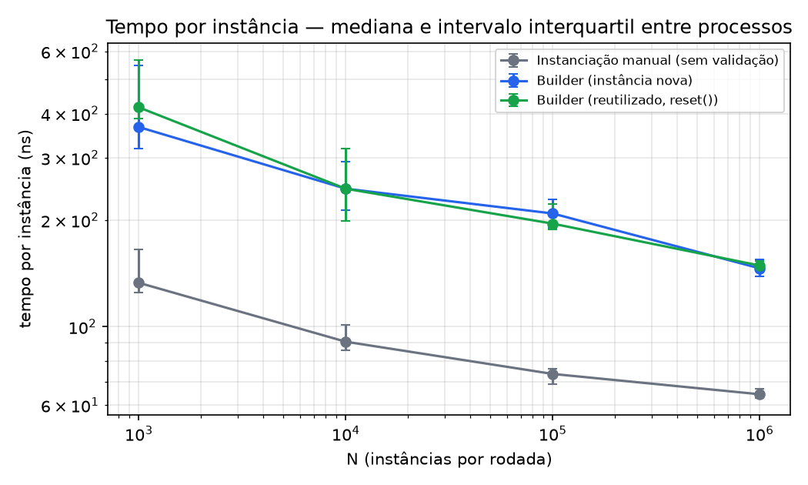
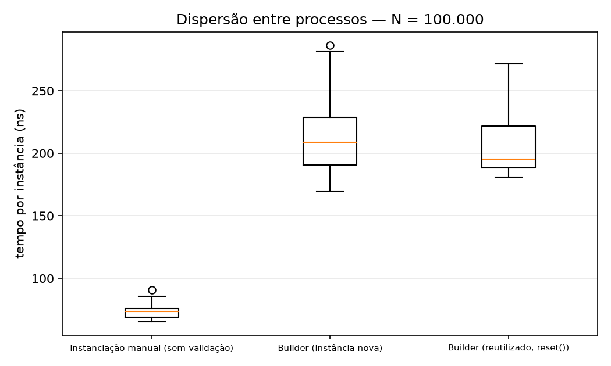
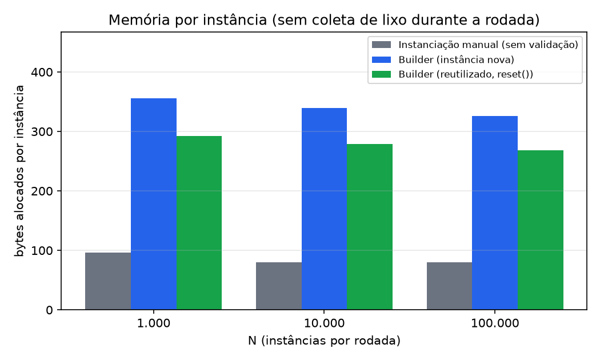

# Benchmark do Builder — tempo e memória (padrão × instanciação manual)

> Relatório **gerado** por [`gerar_relatorio.py`](../gerar_relatorio.py) a partir das medições brutas em [`builder-isolado-brutos.csv`](builder-isolado-brutos.csv). Nenhum número deste arquivo foi digitado à mão. Para refazer: `cd benchmark && uv run python gerar_relatorio.py`.

Complementa a [análise do Heitor](analise-builder.md) (investigação do resultado preliminar sobre D6) com: variação por N, memória medida sem coleta de lixo durante a rodada e gráficos.

## Pergunta

Quanto custa, em tempo e memória, montar um `StreamConfig` pelo Builder em comparação com a instanciação manual, e como esse custo varia com o número de instâncias?

## Ambiente

| Item | Valor |
| --- | --- |
| CPU | 12th Gen Intel(R) Core(TM) i7-1255U (12 threads) |
| Sistema | Linux 7.2.5-3-omarchy |
| Node | v26.8.1 (`--expose-gc`) |
| Python | 3.14.7 |
| Data | 17/10/2026 |
| N (tempo) | 1000, 10000, 100000, 1000000 |
| N (memória) | 1000, 10000, 100000 |
| Repetições | 15 processos por braço e por N; cada processo faz 10 rodadas e informa a mediana |
| Semente | 20261017 (ordem dos braços e bootstrap) |

## Método

1. **Um braço por processo** (`bench/isolado.ts`), com a ordem dos três braços **sorteada a cada repetição**. Assim nenhum braço herda o JIT, o heap ou a frequência de CPU do anterior.
2. **Tempo** com as flags padrão do V8, para que o custo de coleta de lixo conte.
3. **Memória** em fase separada, com semi-space de 128 MB (`--min/--max-semi-space-size`), de modo que nenhuma coleta ocorra durante a rodada e `heapUsed` antes/depois meça alocação de fato. Uma medida é descartada se a alocação da rodada passa de metade do semi-space. Por isso não há memória para os N maiores.
4. **Estatística:** mediana e intervalo interquartil **entre processos**; razões **pareadas** (mesma repetição) com IC 95% por bootstrap de 10.000 reamostragens.

Braços (definidos em [`bench/cenarios/builder.ts`](../../bench/cenarios/builder.ts)):

| Braço | O que faz |
| --- | --- |
| `manual` | Literal congelado com os mesmos campos, **sem nenhuma validação** (alternativa B do ADR-001) |
| `builder-novo` | Um `DefaultStreamConfigBuilder` por configuração, com validação em `build()` |
| `builder-reutilizado` | Um builder único com `reset()`, como o Director usa (decisão D6) |

## Resultados — tempo

| N | Braço | Mediana (ns/instância) | Intervalo interquartil | Razão sobre o manual |
| --- | --- | --- | --- | --- |
| 1000 | `manual` | 133,0 | 124,8 – 165,3 | 1,0× |
| 1000 | `builder-novo` | 366,4 | 318,7 – 546,3 | 2,8× |
| 1000 | `builder-reutilizado` | 416,5 | 386,4 – 566,9 | 3,1× |
| 10000 | `manual` | 90,7 | 85,7 – 101,3 | 1,0× |
| 10000 | `builder-novo` | 245,4 | 213,2 – 293,2 | 2,7× |
| 10000 | `builder-reutilizado` | 245,3 | 198,8 – 318,9 | 2,7× |
| 100000 | `manual` | 73,5 | 68,8 – 75,9 | 1,0× |
| 100000 | `builder-novo` | 208,8 | 190,6 – 228,7 | 2,8× |
| 100000 | `builder-reutilizado` | 195,5 | 188,5 – 222,0 | 2,7× |
| 1000000 | `manual` | 64,4 | 63,0 – 66,6 | 1,0× |
| 1000000 | `builder-novo` | 146,2 | 139,0 – 154,7 | 2,3× |
| 1000000 | `builder-reutilizado` | 148,8 | 145,7 – 153,4 | 2,3× |

*Figura 1 — Tempo por instância em função de N (eixos logarítmicos). Barras: intervalo interquartil entre processos.*

### Razões pareadas

| N | Comparação | Razão mediana pareada | IC 95% | Pares em que a razão ficou abaixo de 1 |
| --- | --- | --- | --- | --- |
| 1000 | `builder-novo` ÷ `manual` | 2,71× | 2,01 – 3,33 | 1 de 15 |
| 1000 | `builder-reutilizado` ÷ `builder-novo` | 1,13× | 0,77 – 1,89 | 5 de 15 |
| 10000 | `builder-novo` ÷ `manual` | 2,61× | 2,14 – 3,18 | 0 de 15 |
| 10000 | `builder-reutilizado` ÷ `builder-novo` | 1,11× | 0,95 – 1,22 | 6 de 15 |
| 100000 | `builder-novo` ÷ `manual` | 2,88× | 2,46 – 3,18 | 0 de 15 |
| 100000 | `builder-reutilizado` ÷ `builder-novo` | 0,98× | 0,88 – 1,06 | 10 de 15 |
| 1000000 | `builder-novo` ÷ `manual` | 2,20× | 2,12 – 2,42 | 0 de 15 |
| 1000000 | `builder-reutilizado` ÷ `builder-novo` | 1,03× | 0,97 – 1,07 | 5 de 15 |

Leitura para o maior N:

- **custo do padrão**, N = 1000000: `builder-novo` ficou mais lento que `manual` em 119,9% (IC 95% da razão: 2,12 – 2,42).
- **D6 (reaproveitar o builder)**, N = 1000000: IC 95% da razão contém 1 — **sem diferença mensurável** nesta execução.

*Figura 2 — Dispersão do tempo por instância entre processos, no maior N com tempo medido.*

## Resultados — memória

| N | Braço | Bytes por instância (mediana) | Intervalo interquartil | Validade |
| --- | --- | --- | --- | --- |
| 1000 | `manual` | 97 | 93 – 97 | válida |
| 1000 | `builder-novo` | 356 | 355 – 357 | válida |
| 1000 | `builder-reutilizado` | 292 | 291 – 293 | válida |
| 10000 | `manual` | 80 | 80 – 80 | válida |
| 10000 | `builder-novo` | 339 | 336 – 344 | válida |
| 10000 | `builder-reutilizado` | 279 | 273 – 280 | válida |
| 100000 | `manual` | 80 | 80 – 80 | válida |
| 100000 | `builder-novo` | 326 | 322 – 327 | válida |
| 100000 | `builder-reutilizado` | 269 | 264 – 270 | válida |

Com N = 100000, a mediana foi de **326 B** por instância no `builder-novo`, **269 B** no `builder-reutilizado` e **80 B** no `manual`. O Builder novo aloca 4,1× o que a instanciação manual aloca; a diferença é o objeto do próprio builder e os campos que ele acumula antes de `build()`.

*Figura 3 — Bytes alocados por instância, apenas nos N com medida válida.*

## Limitações

- **O braço `manual` não valida nada.** A diferença entre ele e o Builder é custo do padrão **mais** custo das regras R1–R5; este benchmark não separa as duas parcelas (separá-las exigiria reescrever as regras fora do Builder, o que o padrão existe para evitar).
- **Uma máquina, uma versão do Node, um dia.** Valores absolutos mudam com outra CPU ou outro V8; a razão entre braços tende a ser mais estável, mas isso não foi verificado em outra máquina.
- **Máquina de uso geral, sem controle de frequência da CPU.** A dispersão entre processos vem em parte disso; o pareamento reduz o efeito, não o elimina.
- **Tempo e memória vêm de configurações diferentes do V8** (flags padrão × semi-space grande). Os dois números não saem da mesma execução e não devem ser multiplicados entre si.
- **Memória só para N pequeno e médio.** Para N maiores a alocação da rodada não cabe no semi-space e a medida seria inválida; o script a descarta em vez de publicá-la.
- **Escopo:** apenas o cenário `builder`. O cenário do Factory Method ainda não existe em `bench/cenarios/`.
